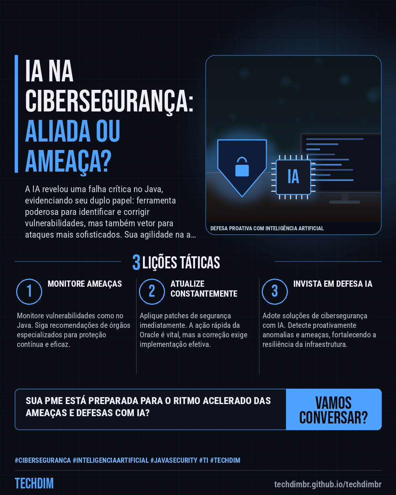
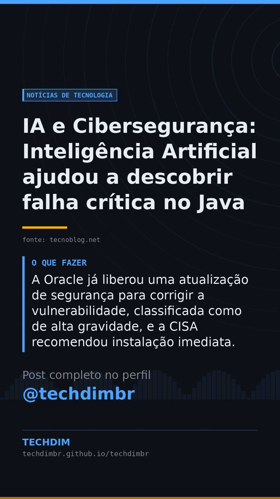

# Notícias de Tecnologia — IA e Cibersegurança: Inteligência Artificial ajudou a descobrir falha crítica no Java

- **Data:** 2026-11-19, 16:28 (horário de Brasília)
- **Curadoria:** Claude (Routine) — pauta do dia
- **Execução no Actions:** https://github.com/Techdimbr/Publi-midia-Techdim/actions/runs/44598530857
- **Por que esta pauta:** Este caso demonstra o papel crescente da inteligência artificial tanto na descoberta de vulnerabilidades quanto na defesa contra elas, impactando diretamente a segurança corporativa.

## Resultado

| Rede | Status | Link | 1º comentário |
|---|---|---|---|
| linkedin | ✅ publicado | https://www.linkedin.com/feed/update/urn:li:share:7529264259839479809/ | — |
| facebook | ✅ publicado | https://www.facebook.com/122132402349390486/posts/122145363717390486 | ✅ |
| instagram | ✅ publicado | https://www.instagram.com/p/Df71PaeGBS0/ | ✅ |
| Stories | ✅ publicado | https://www.instagram.com/stories/techdimbr/4034052189248382604 | — |

## Fontes

- [tecnoblog.net](https://tecnoblog.net/noticias/ia-ajudou-a-descobrir-falha-critica-no-java/)

## Linkedin

```text
IA e Cibersegurança: Inteligência Artificial ajudou a descobrir falha crítica no Java

01. Uma startup de cibersegurança utilizou ferramentas de IA, incluindo GPT-6 Cyber e agente Codex, para identificar uma vulnerabilidade crítica no Java (CVE-2026-114938).
02. A falha, batizada de Java4Shell, reside no decodificador Base64 do OpenJDK e pode permitir a execução remota de códigos, comprometendo sistemas de empresas e órgãos públicos.
03. A Oracle já liberou uma atualização de segurança para corrigir a vulnerabilidade, classificada como de alta gravidade, e a CISA recomendou instalação imediata.

A integração de IA na cibersegurança é uma realidade. A TECHDIM oferece soluções para que sua empresa se beneficie e se defenda nesse cenário.

Fontes: https://tecnoblog.net/noticias/ia-ajudou-a-descobrir-falha-critica-no-java/

TECHDIM — Infraestrutura · Segurança · IA
https://techdimbr.github.io/techdimbr/

#Ciberseguranca #InteligenciaArtificial #JavaSecurity #TI #TECHDIM
```



## Facebook

```text
IA e Cibersegurança: Inteligência Artificial ajudou a descobrir falha crítica no Java

• Uma startup de cibersegurança utilizou ferramentas de IA, incluindo GPT-6 Cyber e agente Codex, para identificar uma vulnerabilidade crítica no Java (CVE-2026-114938).
• A falha, batizada de Java4Shell, reside no decodificador Base64 do OpenJDK e pode permitir a execução remota de códigos, comprometendo sistemas de empresas e órgãos públicos.
• A Oracle já liberou uma atualização de segurança para corrigir a vulnerabilidade, classificada como de alta gravidade, e a CISA recomendou instalação imediata.

A integração de IA na cibersegurança é uma realidade. A TECHDIM oferece soluções para que sua empresa se beneficie e se defenda nesse cenário.

Fale com a TECHDIM — fontes e site no primeiro comentário 👇

#Ciberseguranca #InteligenciaArtificial #JavaSecurity #TECHDIM
```

Primeiro comentário:

```text
📎 Fontes:
• tecnoblog.net: https://tecnoblog.net/noticias/ia-ajudou-a-descobrir-falha-critica-no-java/

🌐 TECHDIM — Infraestrutura · Segurança · IA: https://techdimbr.github.io/techdimbr/
```


## Instagram

```text
IA e Cibersegurança: Inteligência Artificial ajudou a descobrir falha crítica no Java

1️⃣ Uma startup de cibersegurança utilizou ferramentas de IA, incluindo GPT-6 Cyber e agente Codex, para identificar uma vulnerabilidade crítica no Java (CVE-2026-114938).
2️⃣ A falha, batizada de Java4Shell, reside no decodificador Base64 do OpenJDK e pode permitir a execução remota de códigos, comprometendo sistemas de empresas e órgãos públicos.
3️⃣ A Oracle já liberou uma atualização de segurança para corrigir a vulnerabilidade, classificada como de alta gravidade, e a CISA recomendou instalação imediata.

A integração de IA na cibersegurança é uma realidade. A TECHDIM oferece soluções para que sua empresa se beneficie e se defenda nesse cenário.

🔗 Link na bio: techdimbr.github.io/techdimbr
Fontes no primeiro comentário 👇

#ciberseguranca #inteligenciaartificial #javasecurity #ti #techdim #tecnologia #ia #inovacao
```

Primeiro comentário:

```text
📎 Fontes: tecnoblog.net
```


## Stories


