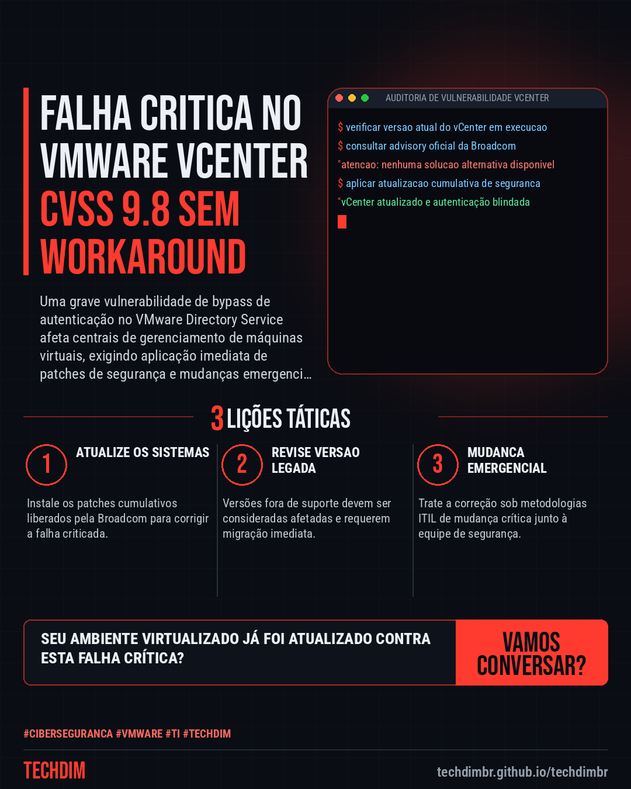
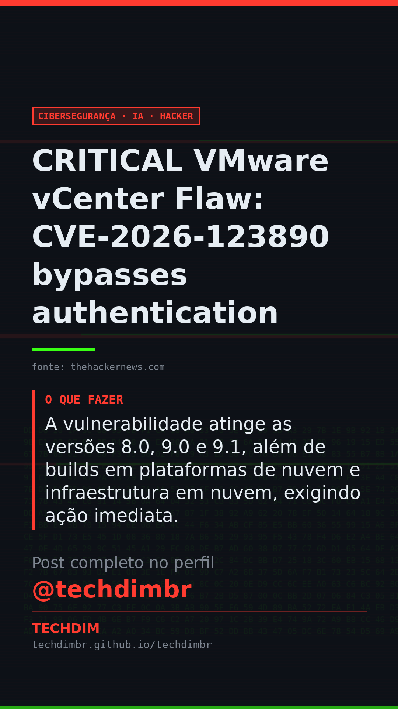

# Cibersegurança · IA · Hacker — CRITICAL VMware vCenter Flaw: CVE-2026-123890 bypasses authentication

- **Data:** 2026-11-19, 19:06 (horário de Brasília)
- **Curadoria:** Claude (Routine) — pauta do dia
- **Execução no Actions:** https://github.com/Techdimbr/Publi-midia-Techdim/actions/runs/44625205260
- **Por que esta pauta:** Alerta crítico de segurança para correção imediata de ambientes virtualizados corporativos.

## Resultado

| Rede | Status | Link | 1º comentário |
|---|---|---|---|
| linkedin | ✅ publicado | https://www.linkedin.com/feed/update/urn:li:share:7529303956783529984/ | — |
| facebook | ✅ publicado | https://www.facebook.com/122132402349390486/posts/122145384633390486 | ✅ |
| instagram | ✅ publicado | https://www.instagram.com/p/Df8HSRmiSRB/ | ✅ |
| Stories | ✅ publicado | https://www.instagram.com/stories/techdimbr/4034131547008237729 | — |

## Fontes

- [thehackernews.com](https://thehackernews.com/2026/11/critical-vmware-vcenter-flaw-cvss-98.html)

## Linkedin

```text
CRITICAL VMware vCenter Flaw: CVE-2026-123890 bypasses authentication

01. Uma falha crítica de bypass de autenticação no VMware vCenter (CVE-2026-123890), com pontuação CVSS de 9.8, afeta o VMware Directory Service.
02. A Broadcom informou que atualizações cumulativas estão disponíveis para versões suportadas, sem a existência de contornos alternativos oficiais.
03. A vulnerabilidade atinge as versões 8.0, 9.0 e 9.1, além de builds em plataformas de nuvem e infraestrutura em nuvem, exigindo ação imediata.

Proteja a infraestrutura da sua PME com governança e atualizações rigorosas. Consulte a TECHDIM.

Fontes: https://thehackernews.com/2026/11/critical-vmware-vcenter-flaw-cvss-98.html

TECHDIM — Infraestrutura · Segurança · IA
https://techdimbr.github.io/techdimbr/

#Ciberseguranca #VMware #TI #TECHDIM #SegurancaDaInformacao
```



## Facebook

```text
CRITICAL VMware vCenter Flaw: CVE-2026-123890 bypasses authentication

• Uma falha crítica de bypass de autenticação no VMware vCenter (CVE-2026-123890), com pontuação CVSS de 9.8, afeta o VMware Directory Service.
• A Broadcom informou que atualizações cumulativas estão disponíveis para versões suportadas, sem a existência de contornos alternativos oficiais.
• A vulnerabilidade atinge as versões 8.0, 9.0 e 9.1, além de builds em plataformas de nuvem e infraestrutura em nuvem, exigindo ação imediata.

Proteja a infraestrutura da sua PME com governança e atualizações rigorosas. Consulte a TECHDIM.

Fale com a TECHDIM — fontes e site no primeiro comentário 👇

#Ciberseguranca #VMware #TI #TECHDIM
```

Primeiro comentário:

```text
📎 Fontes:
• thehackernews.com: https://thehackernews.com/2026/11/critical-vmware-vcenter-flaw-cvss-98.html

🌐 TECHDIM — Infraestrutura · Segurança · IA: https://techdimbr.github.io/techdimbr/
```


## Instagram

```text
CRITICAL VMware vCenter Flaw: CVE-2026-123890 bypasses authentication

1️⃣ Uma falha crítica de bypass de autenticação no VMware vCenter (CVE-2026-123890), com pontuação CVSS de 9.8, afeta o VMware Directory Service.
2️⃣ A Broadcom informou que atualizações cumulativas estão disponíveis para versões suportadas, sem a existência de contornos alternativos oficiais.
3️⃣ A vulnerabilidade atinge as versões 8.0, 9.0 e 9.1, além de builds em plataformas de nuvem e infraestrutura em nuvem, exigindo ação imediata.

Proteja a infraestrutura da sua PME com governança e atualizações rigorosas. Consulte a TECHDIM.

🔗 Link na bio: techdimbr.github.io/techdimbr
Fontes no primeiro comentário 👇

#ciberseguranca #vmware #ti #techdim #seguranca #hacker #infraestrutura #campinas
```

Primeiro comentário:

```text
📎 Fontes: thehackernews.com
```


## Stories


