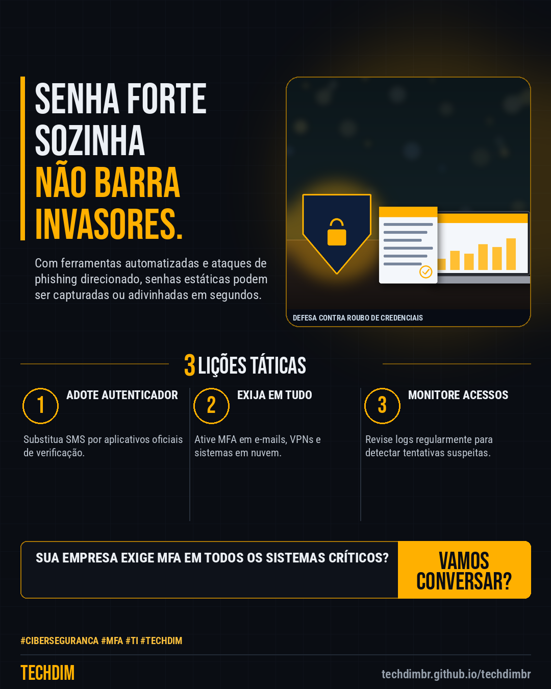

# Conhecimento — MFA corporativo: por que senha forte já não basta para proteger sua PME

- **Data:** 2026-11-19, 20:37 (horário de Brasília)
- **Curadoria:** Claude (Routine) — pauta do dia
- **Execução no Actions:** https://github.com/Techdimbr/Publi-midia-Techdim/actions/runs/44639146008
- **Por que esta pauta:** Credenciais comprometidas continuam sendo o principal vetor inicial de invasões em redes corporativas.

## Resultado

| Rede | Status | Link | 1º comentário |
|---|---|---|---|
| linkedin | ✅ publicado | https://www.linkedin.com/feed/update/urn:li:share:7529326985156947968/ | — |
| facebook | ✅ publicado | https://www.facebook.com/122132402349390486/posts/122145397737390486 | ✅ |
| instagram | ✅ publicado | https://www.instagram.com/p/Df8RwafF_6S/ | — |

## Linkedin

```text
MFA corporativo: por que senha forte já não basta para proteger sua PME

01. Senhas complexas caem facilmente frente a ataques modernos de phishing avançado e roubo de sessões.
02. A autenticação multifator adiciona camadas vitais, exigindo confirmações adicionais por aplicativo autenticador ou chave física.
03. Implementar MFA em todos os acessos corporativos reduz drasticamente o risco de invasões por credenciais vazadas.

A TECHDIM implementa políticas rigorosas de acesso e MFA para blindar sua PME.

TECHDIM — Infraestrutura · Segurança · IA
https://techdimbr.github.io/techdimbr/

#Ciberseguranca #MFA #TI #TECHDIM #Conhecimento
```



## Facebook

```text
MFA corporativo: por que senha forte já não basta para proteger sua PME

• Senhas complexas caem facilmente frente a ataques modernos de phishing avançado e roubo de sessões.
• A autenticação multifator adiciona camadas vitais, exigindo confirmações adicionais por aplicativo autenticador ou chave física.
• Implementar MFA em todos os acessos corporativos reduz drasticamente o risco de invasões por credenciais vazadas.

A TECHDIM implementa políticas rigorosas de acesso e MFA para blindar sua PME.

Fale com a TECHDIM — link no primeiro comentário 👇

#Ciberseguranca #MFA #TI #TECHDIM
```

Primeiro comentário:

```text
🌐 TECHDIM — Infraestrutura · Segurança · IA: https://techdimbr.github.io/techdimbr/
```


## Instagram

```text
MFA corporativo: por que senha forte já não basta para proteger sua PME

1️⃣ Senhas complexas caem facilmente frente a ataques modernos de phishing avançado e roubo de sessões.
2️⃣ A autenticação multifator adiciona camadas vitais, exigindo confirmações adicionais por aplicativo autenticador ou chave física.
3️⃣ Implementar MFA em todos os acessos corporativos reduz drasticamente o risco de invasões por credenciais vazadas.

A TECHDIM implementa políticas rigorosas de acesso e MFA para blindar sua PME.

🔗 Link na bio: techdimbr.github.io/techdimbr

#ciberseguranca #mfa #ti #techdim #conhecimento #aprendati #tecnologia #campinas
```


