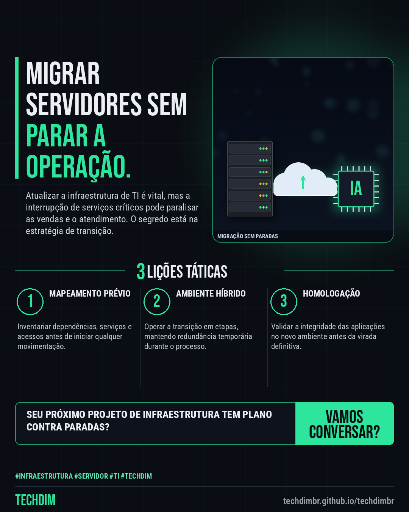

# TECHDIM · Serviços — INFRAESTRUTURA: Migração de servidor sem parar a empresa

- **Data:** 2026-11-19, 22:49 (horário de Brasília)
- **Curadoria:** Claude (Routine) — pauta do dia
- **Execução no Actions:** https://github.com/Techdimbr/Publi-midia-Techdim/actions/runs/44656298745
- **Por que esta pauta:** Muitas PMEs adiam atualizações de infraestrutura por medo de paradas prolongadas no negócio.

## Resultado

| Rede | Status | Link | 1º comentário |
|---|---|---|---|
| linkedin | ✅ publicado | https://www.linkedin.com/feed/update/urn:li:share:7529360148285546496/ | — |
| facebook | ✅ publicado | https://www.facebook.com/122132402349390486/posts/122145412389390486 | ✅ |
| instagram | ✅ publicado | https://www.instagram.com/p/Df8g1okl4Kp/ | — |

## Linkedin

```text
INFRAESTRUTURA: Migração de servidor sem parar a empresa

01. A substituição ou atualização de servidores centrais é indispensável para evitar gargalos operacionais e falhas de hardware em PMEs.
02. A execução sem planejamento prévio e sem janelas de manutenção adequadas frequentemente resulta em indisponibilidade prolongada e perda de receita.
03. A metodologia da TECHDIM estrutura a transição de workloads de forma gradual e segura, assegurando a continuidade dos negócios.

Conte com a engenharia da TECHDIM para migrar seus servidores com segurança e sem impacto operacional.

TECHDIM — Infraestrutura · Segurança · IA
https://techdimbr.github.io/techdimbr/

#Infraestrutura #Servidor #TI #TECHDIM #InfraestruturaDeTI
```



## Facebook

```text
INFRAESTRUTURA: Migração de servidor sem parar a empresa

• A substituição ou atualização de servidores centrais é indispensável para evitar gargalos operacionais e falhas de hardware em PMEs.
• A execução sem planejamento prévio e sem janelas de manutenção adequadas frequentemente resulta em indisponibilidade prolongada e perda de receita.
• A metodologia da TECHDIM estrutura a transição de workloads de forma gradual e segura, assegurando a continuidade dos negócios.

Conte com a engenharia da TECHDIM para migrar seus servidores com segurança e sem impacto operacional.

Fale com a TECHDIM — link no primeiro comentário 👇

#Infraestrutura #Servidor #TI #TECHDIM
```

Primeiro comentário:

```text
🌐 TECHDIM — Infraestrutura · Segurança · IA: https://techdimbr.github.io/techdimbr/
```


## Instagram

```text
INFRAESTRUTURA: Migração de servidor sem parar a empresa

1️⃣ A substituição ou atualização de servidores centrais é indispensável para evitar gargalos operacionais e falhas de hardware em PMEs.
2️⃣ A execução sem planejamento prévio e sem janelas de manutenção adequadas frequentemente resulta em indisponibilidade prolongada e perda de receita.
3️⃣ A metodologia da TECHDIM estrutura a transição de workloads de forma gradual e segura, assegurando a continuidade dos negócios.

Conte com a engenharia da TECHDIM para migrar seus servidores com segurança e sem impacto operacional.

🔗 Link na bio: techdimbr.github.io/techdimbr

#infraestrutura #servidor #ti #techdim #suportetecnico #ciberseguranca #automacao #campinas
```


