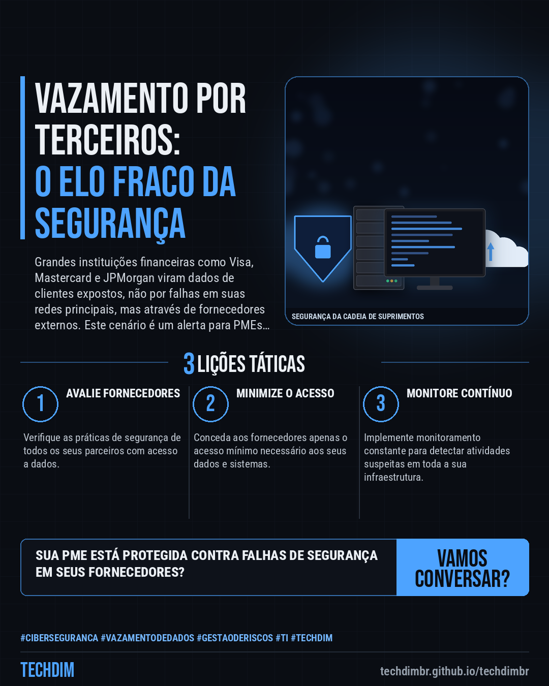

# Notícias de Tecnologia — VAZAMENTO: Dados de clientes Visa, Mastercard e JPMorgan expostos via terceiros

- **Data:** 2026-11-20, 16:04 (horário de Brasília)
- **Curadoria:** Claude (Routine) — pauta do dia
- **Execução no Actions:** https://github.com/Techdimbr/Publi-midia-Techdim/actions/runs/44798606022
- **Por que esta pauta:** Este vazamento destaca a crescente ameaça de ataques via cadeia de suprimentos e a necessidade de proteção robusta.

## Resultado

| Rede | Status | Link | 1º comentário |
|---|---|---|---|
| linkedin | ✅ publicado | https://www.linkedin.com/feed/update/urn:li:share:7529620649980350465/ | — |
| facebook | ✅ publicado | https://www.facebook.com/122132402349390486/posts/122145618543390486 | ✅ |
| instagram | ✅ publicado | https://www.instagram.com/p/Df-XTTKDD1G/ | ✅ |
| Stories | ✅ publicado | https://www.instagram.com/stories/techdimbr/4034764929223105394 | — |

## Fontes

- [tecnoblog.net](https://tecnoblog.net/noticias/grupo-assume-vazamento-de-dados-de-clientes-da-visa-mastercard-e-jpmorgan/)

## Linkedin

```text
VAZAMENTO: Dados de clientes Visa, Mastercard e JPMorgan expostos via terceiros

01. O grupo de extorsão digital n0n reivindicou o vazamento de dados de clientes de Visa, Mastercard e JPMorgan, obtidos via fornecedores terceirizados.
02. Informações como nomes, e-mails e telefones podem ter sido expostas. Empresas afirmam que números de cartões e senhas não foram comprometidos.
03. O incidente ressalta a criticidade da gestão de segurança em toda a cadeia de suprimentos, especialmente com fornecedores que acessam dados sensíveis.

A TECHDIM fortalece sua PME com cibersegurança defensiva e governança de dados, protegendo contra riscos em toda a cadeia de valor.

Fontes: https://tecnoblog.net/noticias/grupo-assume-vazamento-de-dados-de-clientes-da-visa-mastercard-e-jpmorgan/

TECHDIM — Infraestrutura · Segurança · IA
https://techdimbr.github.io/techdimbr/

#Ciberseguranca #VazamentoDeDados #GestaoDeRiscos #TI #TECHDIM
```



## Facebook

```text
VAZAMENTO: Dados de clientes Visa, Mastercard e JPMorgan expostos via terceiros

• O grupo de extorsão digital n0n reivindicou o vazamento de dados de clientes de Visa, Mastercard e JPMorgan, obtidos via fornecedores terceirizados.
• Informações como nomes, e-mails e telefones podem ter sido expostas. Empresas afirmam que números de cartões e senhas não foram comprometidos.
• O incidente ressalta a criticidade da gestão de segurança em toda a cadeia de suprimentos, especialmente com fornecedores que acessam dados sensíveis.

A TECHDIM fortalece sua PME com cibersegurança defensiva e governança de dados, protegendo contra riscos em toda a cadeia de valor.

Fale com a TECHDIM — fontes e site no primeiro comentário 👇

#Ciberseguranca #VazamentoDeDados #GestaoDeRiscos #TECHDIM
```

Primeiro comentário:

```text
📎 Fontes:
• tecnoblog.net: https://tecnoblog.net/noticias/grupo-assume-vazamento-de-dados-de-clientes-da-visa-mastercard-e-jpmorgan/

🌐 TECHDIM — Infraestrutura · Segurança · IA: https://techdimbr.github.io/techdimbr/
```


## Instagram

```text
VAZAMENTO: Dados de clientes Visa, Mastercard e JPMorgan expostos via terceiros

1️⃣ O grupo de extorsão digital n0n reivindicou o vazamento de dados de clientes de Visa, Mastercard e JPMorgan, obtidos via fornecedores terceirizados.
2️⃣ Informações como nomes, e-mails e telefones podem ter sido expostas. Empresas afirmam que números de cartões e senhas não foram comprometidos.
3️⃣ O incidente ressalta a criticidade da gestão de segurança em toda a cadeia de suprimentos, especialmente com fornecedores que acessam dados sensíveis.

A TECHDIM fortalece sua PME com cibersegurança defensiva e governança de dados, protegendo contra riscos em toda a cadeia de valor.

🔗 Link na bio: techdimbr.github.io/techdimbr
Fontes no primeiro comentário 👇

#ciberseguranca #vazamentodedados #gestaoderiscos #ti #techdim #tecnologia #inteligenciaartificial #ia
```

Primeiro comentário:

```text
📎 Fontes: tecnoblog.net
```


## Stories


