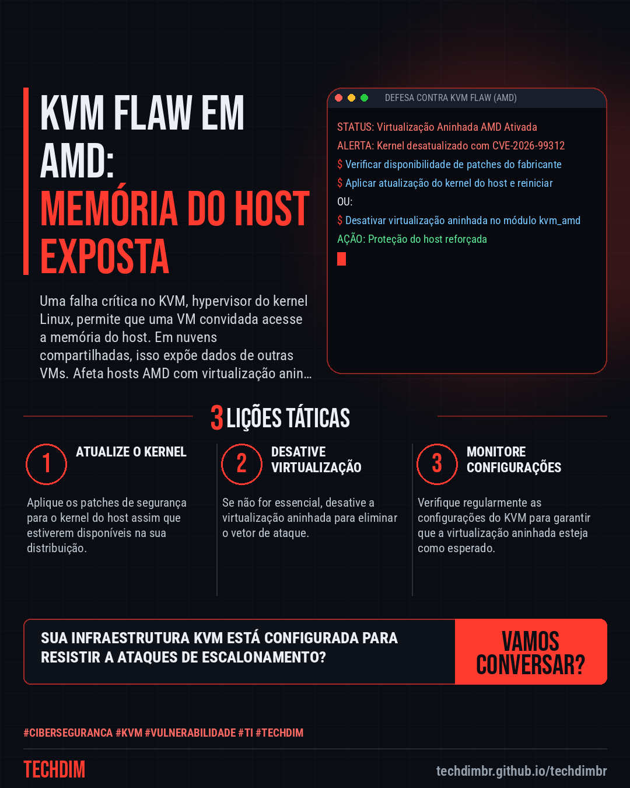
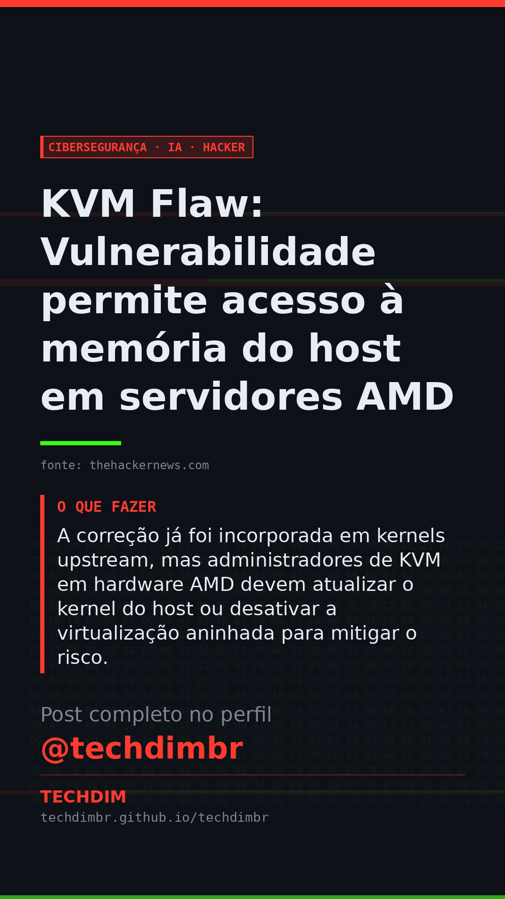

# Cibersegurança · IA · Hacker — KVM Flaw: Vulnerabilidade permite acesso à memória do host em servidores AMD

- **Data:** 2026-11-20, 18:46 (horário de Brasília)
- **Curadoria:** Claude (Routine) — pauta do dia
- **Execução no Actions:** https://github.com/Techdimbr/Publi-midia-Techdim/actions/runs/44823067935
- **Por que esta pauta:** Esta falha destaca a importância da gestão de patches e da configuração segura em ambientes de virtualização que afetam diretamente a segurança de PMEs.

## Resultado

| Rede | Status | Link | 1º comentário |
|---|---|---|---|
| linkedin | ✅ publicado | https://www.linkedin.com/feed/update/urn:li:share:7529661295655124992/ | — |
| facebook | ✅ publicado | https://www.facebook.com/122132402349390486/posts/122145640689390486 | ✅ |
| instagram | ✅ publicado | https://www.instagram.com/p/Df-pzBpkh0R/ | ✅ |
| Stories | ✅ publicado | https://www.instagram.com/stories/techdimbr/4034846274058613042 | — |

## Fontes

- [thehackernews.com](https://thehackernews.com/2026/11/new-linux-kvm-flaw-cve-2026-99312-lets.html)

## Linkedin

```text
KVM Flaw: Vulnerabilidade permite acesso à memória do host em servidores AMD

01. A falha CVE-2026-99312 no KVM do Linux permite que VMs convidadas acessem até 127 GB da memória do host em servidores com processadores AMD e virtualização aninhada ativada.
02. Em ambientes de nuvem compartilhada, esta vulnerabilidade pode expor dados de outras máquinas virtuais de clientes, comprometendo a confidencialidade e integridade dos dados.
03. A correção já foi incorporada em kernels upstream, mas administradores de KVM em hardware AMD devem atualizar o kernel do host ou desativar a virtualização aninhada para mitigar o risco.

A proteção de infraestruturas virtualizadas é crucial. A TECHDIM oferece cibersegurança e hardening para blindar seus sistemas.

Fontes: https://thehackernews.com/2026/11/new-linux-kvm-flaw-cve-2026-99312-lets.html

TECHDIM — Infraestrutura · Segurança · IA
https://techdimbr.github.io/techdimbr/

#Ciberseguranca #KVM #Vulnerabilidade #TI #TECHDIM
```



## Facebook

```text
KVM Flaw: Vulnerabilidade permite acesso à memória do host em servidores AMD

• A falha CVE-2026-99312 no KVM do Linux permite que VMs convidadas acessem até 127 GB da memória do host em servidores com processadores AMD e virtualização aninhada ativada.
• Em ambientes de nuvem compartilhada, esta vulnerabilidade pode expor dados de outras máquinas virtuais de clientes, comprometendo a confidencialidade e integridade dos dados.
• A correção já foi incorporada em kernels upstream, mas administradores de KVM em hardware AMD devem atualizar o kernel do host ou desativar a virtualização aninhada para mitigar o risco.

A proteção de infraestruturas virtualizadas é crucial. A TECHDIM oferece cibersegurança e hardening para blindar seus sistemas.

Fale com a TECHDIM — fontes e site no primeiro comentário 👇

#Ciberseguranca #KVM #Vulnerabilidade #TECHDIM
```

Primeiro comentário:

```text
📎 Fontes:
• thehackernews.com: https://thehackernews.com/2026/11/new-linux-kvm-flaw-cve-2026-99312-lets.html

🌐 TECHDIM — Infraestrutura · Segurança · IA: https://techdimbr.github.io/techdimbr/
```


## Instagram

```text
KVM Flaw: Vulnerabilidade permite acesso à memória do host em servidores AMD

1️⃣ A falha CVE-2026-99312 no KVM do Linux permite que VMs convidadas acessem até 127 GB da memória do host em servidores com processadores AMD e virtualização aninhada ativada.
2️⃣ Em ambientes de nuvem compartilhada, esta vulnerabilidade pode expor dados de outras máquinas virtuais de clientes, comprometendo a confidencialidade e integridade dos dados.
3️⃣ A correção já foi incorporada em kernels upstream, mas administradores de KVM em hardware AMD devem atualizar o kernel do host ou desativar a virtualização aninhada para mitigar o risco.

A proteção de infraestruturas virtualizadas é crucial. A TECHDIM oferece cibersegurança e hardening para blindar seus sistemas.

🔗 Link na bio: techdimbr.github.io/techdimbr
Fontes no primeiro comentário 👇

#ciberseguranca #kvm #vulnerabilidade #ti #techdim #seguranca #hacker #infraestrutura
```

Primeiro comentário:

```text
📎 Fontes: thehackernews.com
```


## Stories


