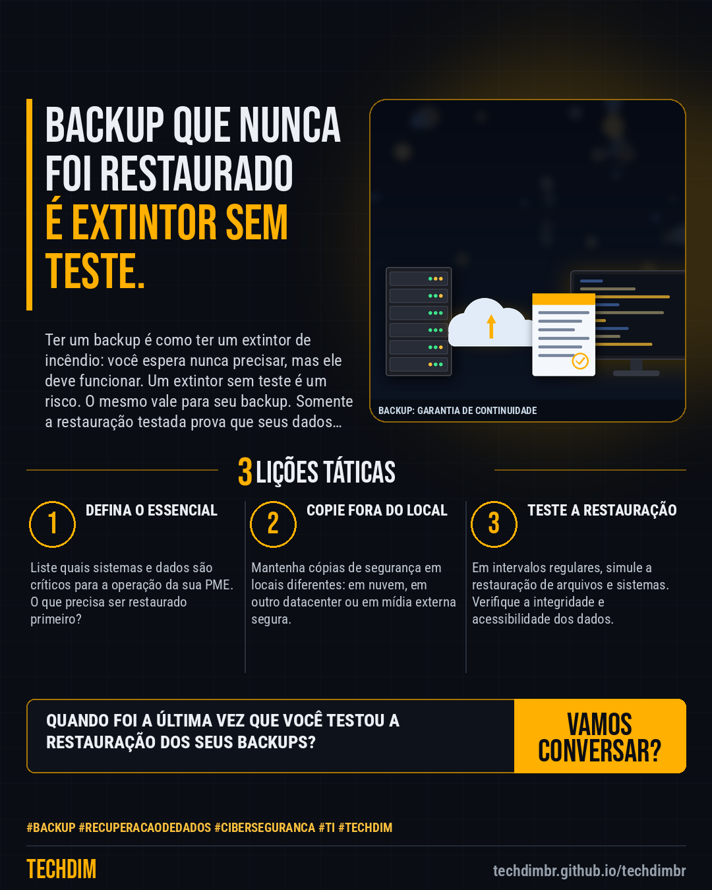

# Conhecimento — BACKUP: Teste sua restauração ou seu backup pode ser inútil

- **Data:** 2026-11-20, 20:10 (horário de Brasília)
- **Curadoria:** Claude (Routine) — pauta do dia
- **Execução no Actions:** https://github.com/Techdimbr/Publi-midia-Techdim/actions/runs/44834656634
- **Por que esta pauta:** Este assunto é vital hoje para garantir que as PMEs brasileiras possam se recuperar efetivamente de incidentes de dados.

## Resultado

| Rede | Status | Link | 1º comentário |
|---|---|---|---|
| linkedin | ✅ publicado | https://www.linkedin.com/feed/update/urn:li:share:7529682442308235264/ | — |
| facebook | ✅ publicado | https://www.facebook.com/122132402349390486/posts/122145651657390486 | ✅ |
| instagram | ✅ publicado | https://www.instagram.com/p/Df-zaRvCZ5q/ | — |

## Linkedin

```text
BACKUP: Teste sua restauração ou seu backup pode ser inútil

01. Apenas ter cópias de segurança não garante a recuperação de dados em caso de falha; o teste de restauração é crucial para validar a eficácia do backup.
02. Empresas frequentemente investem em soluções de backup robustas, mas negligenciam a etapa vital de verificar se os dados podem ser restaurados corretamente.
03. Um backup não testado pode gerar uma falsa sensação de segurança, expondo a PME a perdas irrecuperáveis e interrupções prolongadas em momentos críticos.

A TECHDIM projeta e implementa estratégias de backup e recuperação, garantindo a continuidade da sua PME com testes regulares.

TECHDIM — Infraestrutura · Segurança · IA
https://techdimbr.github.io/techdimbr/

#Backup #RecuperacaoDeDados #Ciberseguranca #TI #TECHDIM
```



## Facebook

```text
BACKUP: Teste sua restauração ou seu backup pode ser inútil

• Apenas ter cópias de segurança não garante a recuperação de dados em caso de falha; o teste de restauração é crucial para validar a eficácia do backup.
• Empresas frequentemente investem em soluções de backup robustas, mas negligenciam a etapa vital de verificar se os dados podem ser restaurados corretamente.
• Um backup não testado pode gerar uma falsa sensação de segurança, expondo a PME a perdas irrecuperáveis e interrupções prolongadas em momentos críticos.

A TECHDIM projeta e implementa estratégias de backup e recuperação, garantindo a continuidade da sua PME com testes regulares.

Fale com a TECHDIM — link no primeiro comentário 👇

#Backup #RecuperacaoDeDados #Ciberseguranca #TECHDIM
```

Primeiro comentário:

```text
🌐 TECHDIM — Infraestrutura · Segurança · IA: https://techdimbr.github.io/techdimbr/
```


## Instagram

```text
BACKUP: Teste sua restauração ou seu backup pode ser inútil

1️⃣ Apenas ter cópias de segurança não garante a recuperação de dados em caso de falha; o teste de restauração é crucial para validar a eficácia do backup.
2️⃣ Empresas frequentemente investem em soluções de backup robustas, mas negligenciam a etapa vital de verificar se os dados podem ser restaurados corretamente.
3️⃣ Um backup não testado pode gerar uma falsa sensação de segurança, expondo a PME a perdas irrecuperáveis e interrupções prolongadas em momentos críticos.

A TECHDIM projeta e implementa estratégias de backup e recuperação, garantindo a continuidade da sua PME com testes regulares.

🔗 Link na bio: techdimbr.github.io/techdimbr

#backup #recuperacaodedados #ciberseguranca #ti #techdim #conhecimento #aprendati #tecnologia
```


