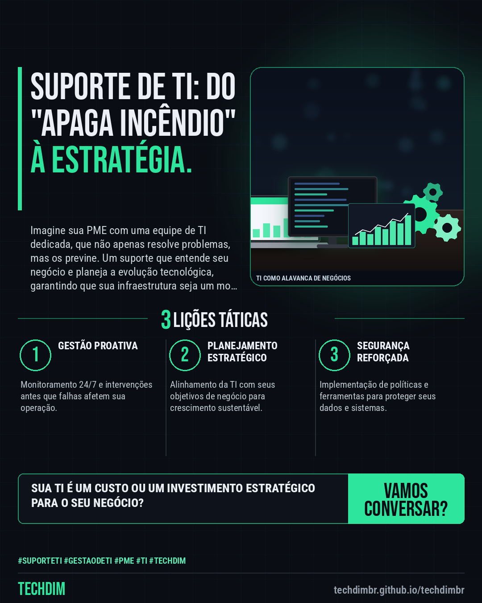

# TECHDIM · Serviços — Suporte de TI: Sua PME merece um parceiro, não um "quebra-galho" reativo.

- **Data:** 2026-11-20, 22:37 (horário de Brasília)
- **Curadoria:** Claude (Routine) — pauta do dia
- **Execução no Actions:** https://github.com/Techdimbr/Publi-midia-Techdim/actions/runs/44851163406
- **Por que esta pauta:** A gestão de TI é crucial para a continuidade e segurança das operações de qualquer PME no cenário atual.

## Resultado

| Rede | Status | Link | 1º comentário |
|---|---|---|---|
| linkedin | ✅ publicado | https://www.linkedin.com/feed/update/urn:li:share:7529719450670092288/ | — |
| facebook | ✅ publicado | https://www.facebook.com/122132402349390486/posts/122145669291390486 | ✅ |
| instagram | ✅ publicado | https://www.instagram.com/p/Df_EPBXCSX_/ | — |

## Linkedin

```text
Suporte de TI: Sua PME merece um parceiro, não um "quebra-galho" reativo.

01. Muitas PMEs enfrentam a frustração de um suporte de TI reativo, que só age quando o problema já está impactando a operação, gerando custos e perdas.
02. A falta de um suporte proativo e estratégico resulta em paradas inesperadas, perda de produtividade e vulnerabilidades que comprometem a segurança dos dados.
03. Um parceiro de TI especializado oferece gestão contínua, monitoramento preventivo e planejamento de infraestrutura, garantindo estabilidade e crescimento.

A TECHDIM fornece suporte de TI gerenciado, transformando a TI da sua PME em um ativo estratégico que impulsiona seus resultados.

TECHDIM — Infraestrutura · Segurança · IA
https://techdimbr.github.io/techdimbr/

#SuporteTI #GestaoDeTI #PME #TI #TECHDIM
```



## Facebook

```text
Suporte de TI: Sua PME merece um parceiro, não um "quebra-galho" reativo.

• Muitas PMEs enfrentam a frustração de um suporte de TI reativo, que só age quando o problema já está impactando a operação, gerando custos e perdas.
• A falta de um suporte proativo e estratégico resulta em paradas inesperadas, perda de produtividade e vulnerabilidades que comprometem a segurança dos dados.
• Um parceiro de TI especializado oferece gestão contínua, monitoramento preventivo e planejamento de infraestrutura, garantindo estabilidade e crescimento.

A TECHDIM fornece suporte de TI gerenciado, transformando a TI da sua PME em um ativo estratégico que impulsiona seus resultados.

Fale com a TECHDIM — link no primeiro comentário 👇

#SuporteTI #GestaoDeTI #PME #TECHDIM
```

Primeiro comentário:

```text
🌐 TECHDIM — Infraestrutura · Segurança · IA: https://techdimbr.github.io/techdimbr/
```


## Instagram

```text
Suporte de TI: Sua PME merece um parceiro, não um "quebra-galho" reativo.

1️⃣ Muitas PMEs enfrentam a frustração de um suporte de TI reativo, que só age quando o problema já está impactando a operação, gerando custos e perdas.
2️⃣ A falta de um suporte proativo e estratégico resulta em paradas inesperadas, perda de produtividade e vulnerabilidades que comprometem a segurança dos dados.
3️⃣ Um parceiro de TI especializado oferece gestão contínua, monitoramento preventivo e planejamento de infraestrutura, garantindo estabilidade e crescimento.

A TECHDIM fornece suporte de TI gerenciado, transformando a TI da sua PME em um ativo estratégico que impulsiona seus resultados.

🔗 Link na bio: techdimbr.github.io/techdimbr

#suporteti #gestaodeti #pme #ti #techdim #suportetecnico #ciberseguranca #automacao
```


